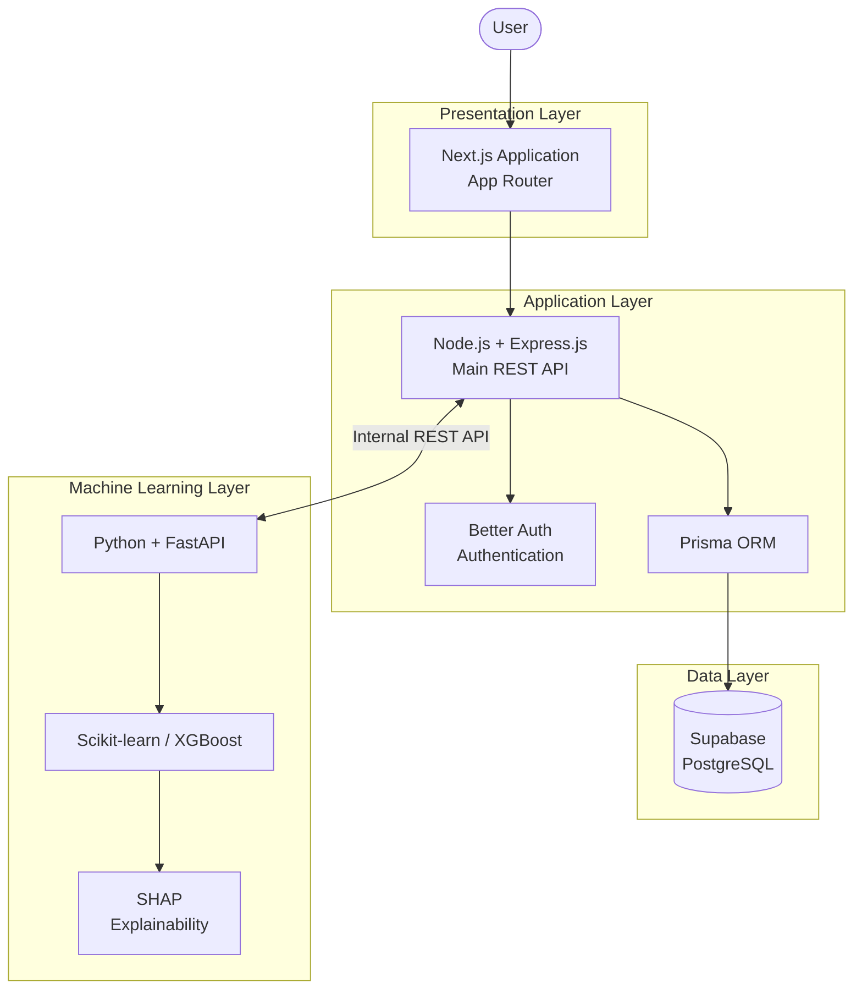
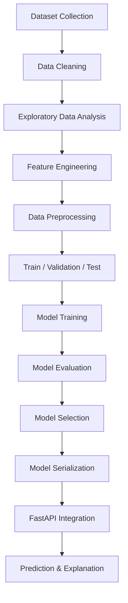

# MediPredict

### Intelligent Healthcare Risk Prediction & Explainable AI Platform

<p align="center">
  An AI-powered healthcare platform designed to make health risk prediction more accessible, transparent, and understandable.
</p>

<p align="center">
  
  
  
  
  
  
</p>

---

## Overview

**MediPredict** is an AI-powered healthcare risk prediction platform that leverages machine learning and explainable artificial intelligence to help users better understand potential health risks.

The platform focuses on two initial prediction domains:

- **Diabetes Risk Prediction**
- **Heart Disease Risk Prediction**

Unlike conventional prediction systems that return only a numerical result, MediPredict aims to provide interpretable insights into how individual health parameters influence model predictions.

By combining a modern web application, a dedicated machine learning service, and an explainability layer, MediPredict aims to bridge the gap between machine learning predictions and understandable healthcare insights.

### Our Vision

To make AI-driven health risk assessment more accessible, transparent, and understandable through responsible technology.

---

## Table of Contents

- [Overview](#overview)
- [Core Capabilities](#core-capabilities)
- [System Architecture](#system-architecture)
- [Technology Stack](#technology-stack)
- [Architecture Responsibilities](#architecture-responsibilities)
- [Machine Learning Pipeline](#machine-learning-pipeline)
- [Explainable AI](#explainable-ai)
- [Database Design](#database-design)
- [Authentication & Authorization](#authentication--authorization)
- [API Design](#api-design)
- [Project Structure](#project-structure)
- [Getting Started](#getting-started)
- [Environment Configuration](#environment-configuration)
- [Development Roadmap](#development-roadmap)
- [Security & Privacy](#security--privacy)
- [Contributing](#contributing)
- [License](#license)

---

## Core Capabilities

### 01. AI-Powered Health Risk Assessment

Provide structured health information and receive machine learning-based risk assessments.

**Initial prediction modules:**
- Diabetes risk assessment.
- Heart disease risk assessment.
- Model-generated prediction scores.
- Structured prediction results.

### 02. Explainable Artificial Intelligence

Make model predictions more transparent using SHAP.

- Individual feature contributions.
- Feature importance analysis.
- Prediction explanation.
- Visual interpretation of model outputs.

### 03. Personalized User Dashboard

A centralized interface for managing personal health assessment activities.

- Health overview.
- Prediction summaries.
- Assessment history.
- Interactive analytics.
- Personal profile management.

### 04. Prediction History & Analytics

- Store prediction records.
- Retrieve previous assessments.
- Review historical results.
- Visualize prediction trends.

### 05. Administration

A dedicated administrative interface designed for platform management.

- User management.
- Platform-level analytics.
- Prediction statistics.
- Administrative access controls.

*These capabilities describe the intended product scope. Individual modules will become available as implementation progresses.*

---

## System Architecture

MediPredict follows a modular, service-oriented architecture with a dedicated application backend and an independent machine learning service.

### High-Level Architecture



### Architecture Principles

- Separation of concerns.
- Independent application and ML services.
- REST-based service communication.
- Centralized relational data management.
- Modular and maintainable codebase.
- Secure authentication and authorization.
- Independent service development and deployment.

---

## Technology Stack

The platform uses a modern JavaScript, TypeScript-compatible, Python, and PostgreSQL ecosystem.

| Layer | Technology | Purpose |
|---|---|---|
| Frontend | Next.js | Web application |
| UI Library | React | Component-based UI |
| Styling | Tailwind CSS | Responsive styling |
| Main Backend | Node.js | Application runtime |
| Backend Framework | Express.js | REST API |
| ML Backend | Python | ML processing |
| ML Framework | FastAPI | ML service APIs |
| Database | PostgreSQL | Relational data storage |
| Database Hosting | Supabase | Managed PostgreSQL |
| ORM | Prisma | Database access |
| Authentication | Better Auth | Authentication and sessions |
| Token Authentication | JWT Plugin | API and service authentication |
| Password Security | Better Auth / scrypt | Password hashing |
| ML Framework | Scikit-learn | Machine learning |
| Gradient Boosting | XGBoost | Predictive modeling |
| Explainable AI | SHAP | Model interpretation |
| Data Processing | Pandas, NumPy | Data analysis |
| API Communication | REST | Service communication |
| Version Control | Git & GitHub | Source control |

---

## Architecture Responsibilities

MediPredict separates application-level business logic from machine learning operations.

### Frontend — Next.js

**Responsibility:** User experience and presentation.

- Application routing.
- Dashboard interfaces.
- Authentication screens.
- Health assessment forms.
- Prediction result visualization.
- SHAP visualization.
- User and admin interfaces.
- API integration.

### Main Backend — Node.js + Express.js

**Responsibility:** Application logic and data management.

- REST API development.
- Authentication integration.
- Authorization and RBAC.
- User and profile management.
- Health data management.
- Prediction request orchestration.
- Communication with FastAPI.
- Database operations through Prisma.
- Prediction history.
- Administrative operations.
- Request validation and error handling.

Express.js is the primary application backend.

### ML Service — Python + FastAPI

**Responsibility:** Machine learning inference and explainability.

- Model initialization and loading.
- Input preprocessing.
- Diabetes prediction.
- Heart disease prediction.
- Model inference.
- SHAP explanation generation.
- ML model evaluation utilities.
- ML service health monitoring.

FastAPI is an independent ML microservice, not a replacement for Express.js.

### Database — Supabase PostgreSQL + Prisma

**Responsibility:** Persistent application data.

- User information.
- Authentication records.
- Health profiles.
- Prediction records.
- Prediction results.
- Historical assessment data.

Better Auth and application models use the same PostgreSQL database through the configured Prisma integration.

---

## Machine Learning Pipeline

MediPredict uses supervised machine learning to develop its initial prediction models.

### Prediction Domains

**Diabetes Risk Prediction**

Potential dataset:
- Pima Indians Diabetes Database.

Candidate algorithms:
- Logistic Regression.
- Random Forest.
- Support Vector Machine.
- XGBoost.

**Heart Disease Risk Prediction**

Potential dataset:
- UCI Heart Disease Dataset.

Candidate algorithms:
- Logistic Regression.
- Random Forest.
- Support Vector Machine.
- XGBoost.

### Model Development Lifecycle



### Model Evaluation Metrics

| Metric | Purpose |
|---|---|
| Accuracy | Overall classification performance |
| Precision | Positive prediction reliability |
| Recall | Positive case detection |
| F1-Score | Precision-recall balance |
| ROC-AUC | Classification discrimination |
| Confusion Matrix | Classification error analysis |

Model selection will consider class imbalance, validation methodology, generalization, and the cost of false-negative predictions.

No model performance claims will be made without experimental evaluation.

---

## Explainable AI — SHAP

MediPredict integrates **SHAP (SHapley Additive exPlanations)** to improve model interpretability.

SHAP estimates how individual input features contribute to a model's output.

### Planned Explainability Features

- Global feature importance.
- Local prediction explanations.
- Positive feature contributions.
- Negative feature contributions.
- Feature contribution visualizations.
- Model interpretation summaries.

### Explainability Workflow

```text
Patient Health Parameters
          |
          v
   Trained ML Model
          |
          v
   Prediction Output
          |
          v
     SHAP Explainer
          |
          v
 Feature Contributions
          |
          v
  Explainable Result
```

SHAP explanations describe model behavior, not clinical causation.

---

## Database Design

**Database:** PostgreSQL  
**Infrastructure:** Supabase  
**ORM:** Prisma

### Planned Core Entities

| Entity | Description |
|---|---|
| User | Application user information |
| Session | Authentication sessions |
| Account | Authentication account records |
| Verification | Verification records |
| HealthProfile | User health information |
| Prediction | Prediction request and metadata |
| PredictionResult | Model output and result details |

### Database Architecture

```text
Express.js Application
         |
         v
      Prisma ORM
         |
         v
  PostgreSQL Database
         |
         v
       Supabase
```

The final schema, relationships, constraints, and indexing strategy will be documented as database implementation progresses.

---

## Authentication & Authorization

MediPredict uses **Better Auth with its JWT Plugin**.

### Better Auth

- User registration.
- Login and logout.
- Session management.
- Password hashing.
- Account management.
- Authentication database integration.

### JWT Plugin

- Signed token generation.
- Token verification.
- API authentication.
- Service-to-service authentication.
- Token expiration validation.
- Issuer and audience validation.

### Role-Based Access Control

| Role | Access |
|---|---|
| USER | Personal dashboard, profile and predictions |
| ADMIN | Administrative features and platform management |
| DOCTOR | Optional future healthcare professional functionality |

Authentication sessions and JWT-based API authentication are handled according to their respective security requirements.

---

## API Design

The API architecture is divided into two independent services.

### Express.js — Application REST API

Base URL:

```text
/api/v1
```

| Module | Responsibilities |
|---|---|
| Authentication | Better Auth integration |
| Users | User profile management |
| Health | Health profile management |
| Predictions | Prediction orchestration |
| History | Historical prediction records |
| Dashboard | User analytics |
| Admin | Platform administration |

### FastAPI — Machine Learning API

Base URL:

```text
http://localhost:8000
```

| Method | Endpoint | Description |
|---|---|---|
| GET | `/health` | Service health |
| GET | `/models` | Available model information |
| POST | `/predict/diabetes` | Diabetes prediction |
| POST | `/predict/heart-disease` | Heart disease prediction |
| POST | `/explain/diabetes` | Diabetes SHAP explanation |
| POST | `/explain/heart-disease` | Heart disease SHAP explanation |

These are proposed API contracts. Implementation and request/response schemas will be documented separately.

### Service Communication

```text
Next.js
   |
   | HTTPS / REST
   v
Express.js
   |
   | Authentication
   | Input Validation
   | Business Logic
   |
   +-----------> PostgreSQL
   |
   | Internal REST Request
   v
FastAPI
   |
   v
ML Models + SHAP
   |
   v
Prediction Response
   |
   v
Express.js
   |
   v
Next.js
```

The ML service will not independently manage application users or application database workflows.

---

## Project Structure

The following represents the planned repository organization. Directories may be introduced incrementally as the corresponding services are developed.

```text
MediPredict/
│
├── frontend/
│   ├── public/
│   ├── src/
│   │   ├── app/
│   │   ├── components/
│   │   ├── features/
│   │   ├── hooks/
│   │   ├── lib/
│   │   ├── services/
│   │   ├── types/
│   │   └── utils/
│   ├── package.json
│   └── .env.local
│
├── backend/
│   ├── src/
│   │   ├── config/
│   │   ├── controllers/
│   │   ├── middlewares/
│   │   ├── routes/
│   │   ├── services/
│   │   ├── validators/
│   │   ├── utils/
│   │   └── server.js
│   │
│   ├── prisma/
│   │   └── schema.prisma
│   ├── package.json
│   └── .env
│
├── ml-service/
│   ├── app/
│   │   ├── api/
│   │   ├── core/
│   │   ├── models/
│   │   ├── schemas/
│   │   ├── services/
│   │   └── main.py
│   │
│   ├── notebooks/
│   ├── trained_models/
│   └── requirements.txt
│
├── dataset/
│   ├── diabetes/
│   └── heart-disease/
│
├── docs/
│   ├── ARCHITECTURE.md
│   ├── API_DOCUMENTATION.md
│   └── DATABASE_SCHEMA.md
│
├── tests/
│   ├── frontend/
│   ├── backend/
│   └── ml-service/
│
├── .gitignore
└── README.md
```

---

## Getting Started

### Prerequisites

Ensure the following tools are installed:

- Node.js (LTS)
- npm
- Python 3
- Git
- Supabase PostgreSQL access

### 1. Clone the Repository

```bash
git clone https://github.com/fahimshahariar56/MediPredict.git
cd MediPredict
```

### 2. Frontend Setup

```bash
cd frontend
npm install
npm run dev
```

Frontend development server:

```text
http://localhost:3000
```

### 3. Backend Setup

Open another terminal:

```bash
cd backend
npm install
npm run dev
```

Backend development server:

```text
http://localhost:5000
```

### 4. Database Setup

Configure the PostgreSQL connection before running Prisma.

```bash
npx prisma generate
npx prisma migrate dev
```

Run these commands from the backend directory.

### 5. ML Service Setup

```bash
cd ml-service
python -m venv venv
```

Activate the environment on Windows:

```powershell
.\venv\Scripts\Activate.ps1
```

Install dependencies:

```bash
pip install -r requirements.txt
```

Start the ML service:

```bash
uvicorn app.main:app --reload --port 8000
```

FastAPI documentation:

```text
http://localhost:8000/docs
```

---

## Environment Configuration

Each service maintains its own environment configuration.

### Frontend — `frontend/.env.local`

```env
NEXT_PUBLIC_API_URL=http://localhost:5000/api/v1
```

### Backend — `backend/.env`

```env
NODE_ENV=development
PORT=5000

DATABASE_URL=your_supabase_database_url
DIRECT_URL=your_supabase_direct_connection_url

BETTER_AUTH_SECRET=your_secure_auth_secret
BETTER_AUTH_URL=http://localhost:5000

FRONTEND_URL=http://localhost:3000
ML_SERVICE_URL=http://localhost:8000
```

### ML Service — `ml-service/.env`

```env
APP_ENV=development
PORT=8000

JWT_ISSUER=your_configured_issuer
JWT_AUDIENCE=your_configured_audience
JWT_PUBLIC_KEY=your_configured_public_key
```

**Important:**

- Never commit environment files.
- Use strong, randomly generated secrets.
- Never expose private credentials in frontend code.
- Configure JWT verification according to the actual Better Auth JWT Plugin signing configuration.
- Restrict internal ML service access to authorized callers.

---

## Development Roadmap

| Phase | Milestone | Status |
|---|---|---|
| 01 | Project initialization | In Progress |
| 02 | Next.js frontend setup | In Progress |
| 03 | Express.js backend setup | In Progress |
| 04 | PostgreSQL & Prisma integration | Planned |
| 05 | Better Auth integration | Planned |
| 06 | Application REST APIs | Planned |
| 07 | ML dataset preparation | Planned |
| 08 | Diabetes prediction model | Planned |
| 09 | Heart disease prediction model | Planned |
| 10 | FastAPI ML service | Planned |
| 11 | SHAP integration | Planned |
| 12 | Frontend and backend integration | Planned |
| 13 | Testing and validation | Planned |
| 14 | Deployment | Planned |

---

## Security & Privacy

Healthcare-related information requires careful handling.

MediPredict aims to follow these security principles:

- Secure authentication and session management.
- Role-based access control.
- Server-side input validation.
- Protected API endpoints.
- Secure database connections.
- Environment-based secret management.
- Rate limiting and request protection.
- Restricted internal service communication.
- Appropriate handling of sensitive health information.

Future deployment must also account for applicable privacy and data protection requirements.

---

## Testing Strategy

Testing will cover all major application layers.

| Layer | Testing Focus |
|---|---|
| Frontend | Component and UI testing |
| Express API | Endpoint and integration testing |
| Database | Schema and data integrity |
| FastAPI | Request and response validation |
| ML Models | Performance and generalization |
| Integration | Cross-service communication |

Testing frameworks will be selected and documented during implementation.

---

## Contributing

Contributions, suggestions, and technical discussions are welcome.

### Development Guidelines

1. Keep application and ML responsibilities separated.
2. Follow consistent naming conventions.
3. Write reusable and maintainable code.
4. Validate all external inputs.
5. Document API changes.
6. Test important functionality before merging.
7. Never commit secrets or sensitive datasets.

### Commit Convention

MediPredict follows Conventional Commits.

| Type | Usage |
|---|---|
| `feat` | New features |
| `fix` | Bug fixes |
| `docs` | Documentation |
| `refactor` | Code restructuring |
| `test` | Tests |
| `chore` | Configuration and maintenance |

Examples:

```bash
git commit -m "feat: add diabetes prediction API"
git commit -m "feat: integrate SHAP explainability"
git commit -m "fix: resolve authentication middleware"
git commit -m "docs: update API documentation"
```

---

## License

The project's license will be specified before public distribution.

---

## Disclaimer

MediPredict is an educational and research-oriented software project.

Its machine learning predictions are experimental estimates and must not be interpreted as medical diagnoses, clinical recommendations, or treatment decisions.

The platform is not a substitute for qualified healthcare professionals. Users should consult appropriate medical professionals for health-related decisions.

---

<p align="center">
  <strong>MediPredict</strong>
  <br/>
  Making Healthcare Insights More Intelligent, Transparent & Accessible.
  <br/><br/>
  Built with AI, Machine Learning & Modern Web Technologies.
</p>