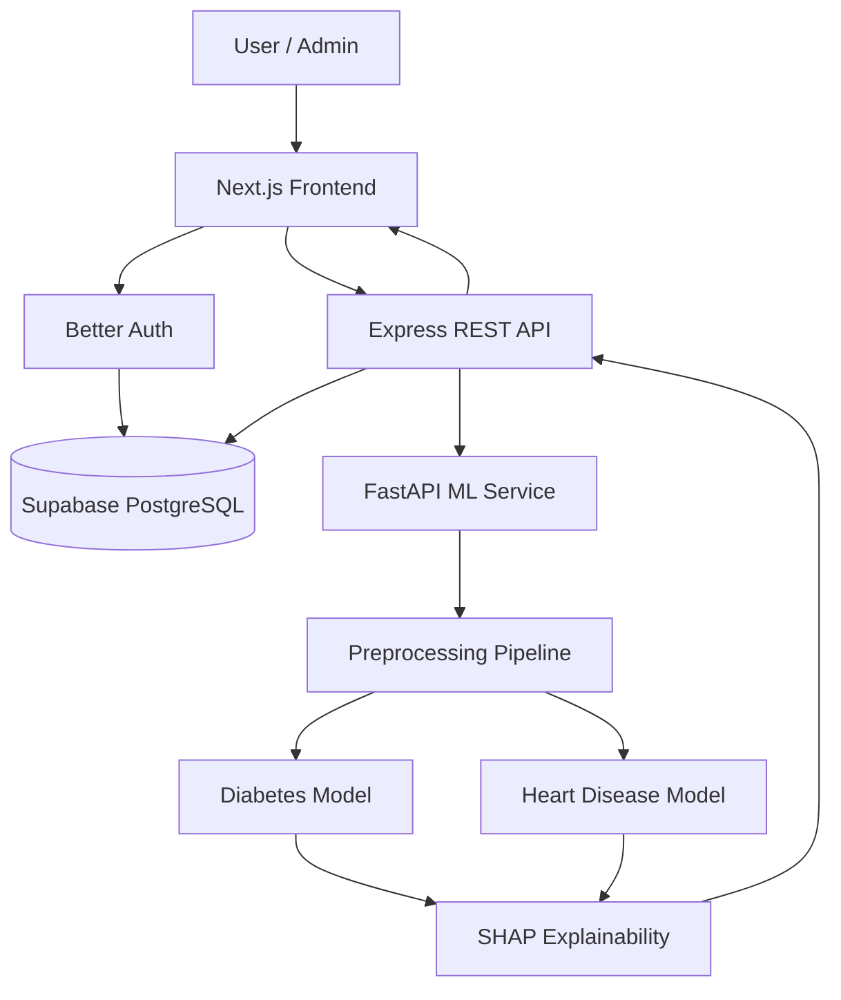
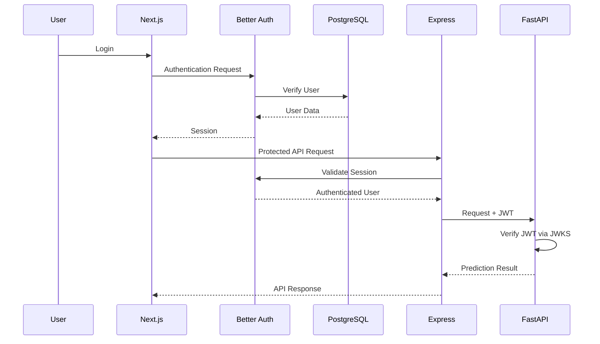
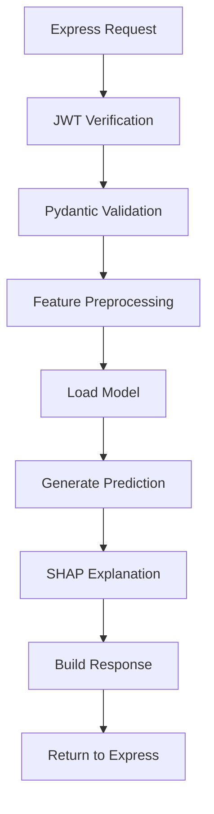

# MediPredict — System Architecture

**Version:** 1.0  
**Status:** Proposed Architecture  
**Project:** MediPredict

---

## 1. Introduction

MediPredict is an Explainable AI-based healthcare risk prediction platform.

The system uses a modular, service-oriented architecture consisting of three primary application layers:

1. Frontend Application
2. Main Application Backend
3. Independent Machine Learning Service

A centralized PostgreSQL database stores application data.

The architecture separates application business logic from machine learning operations to improve maintainability, scalability, and independent development.

## 2. Architecture Overview

### 2.1 High-Level Architecture



### 2.2 Technology Stack

| Layer | Technology |
|---|---|
| Frontend | Next.js App Router |
| Programming Language | TypeScript |
| Styling | Tailwind CSS |
| UI Components | shadcn/ui |
| Main Backend | Node.js |
| Backend Framework | Express.js |
| ML Backend | Python |
| ML Framework | FastAPI |
| Database | Supabase PostgreSQL |
| ORM | Prisma |
| Authentication | Better Auth |
| Token Integration | Better Auth JWT Plugin |
| Token Verification | JWKS |
| ML Libraries | Scikit-learn, XGBoost |
| Explainability | SHAP |
| API Architecture | REST |
| Version Control | Git & GitHub |

## 3. Frontend Architecture

### 3.1 Responsibilities

Next.js is responsible for:

- Rendering user interfaces.
- Public pages.
- Authentication interfaces.
- User dashboard.
- Admin dashboard.
- Prediction forms.
- Prediction results.
- Prediction history.
- API communication.
- Client-side validation.
- Responsive design.

### 3.2 Suggested Structure

```text
frontend/
├── public/
├── src/
│   ├── app/
│   │   ├── (public)/
│   │   ├── (auth)/
│   │   ├── dashboard/
│   │   ├── predictions/
│   │   ├── admin/
│   │   ├── api/
│   │   ├── layout.tsx
│   │   └── page.tsx
│   │
│   ├── components/
│   │   ├── ui/
│   │   ├── layout/
│   │   ├── dashboard/
│   │   ├── predictions/
│   │   └── charts/
│   │
│   ├── features/
│   │   ├── auth/
│   │   ├── users/
│   │   ├── diabetes/
│   │   ├── heart-disease/
│   │   └── history/
│   │
│   ├── lib/
│   ├── hooks/
│   ├── services/
│   ├── types/
│   └── config/
│
├── .env.example
└── package.json
```

### 3.3 Frontend Rules

- Use reusable components.
- Keep business logic outside presentation components.
- Centralize API communication.
- Use TypeScript for type safety.
- Protect authenticated pages.
- Handle loading, error, and empty states.
- Never expose database credentials or ML service secrets.

## 4. Authentication Architecture

### 4.1 Better Auth

Better Auth will manage:

- User registration.
- User login.
- Logout.
- Sessions.
- Password authentication.
- Account management.
- Authentication-related database records.

Prisma Adapter will connect Better Auth with PostgreSQL.

### 4.2 JWT Integration

Better Auth JWT Plugin will issue signed JWTs.

The JWKS endpoint will expose public keys required for signature verification.

The FastAPI service will verify incoming JWTs using the configured JWKS public keys.

### 4.3 Authentication Flow



**Important security decisions:**

- Better Auth is the authentication authority.
- Express is responsible for application authorization.
- FastAPI verifies service-facing JWTs.
- JWT signatures and claims must be validated.
- Use HTTPS in production.
- Do not assume JWT alone replaces authorization checks.
- Do not share passwords or database credentials between services.

The exact JWT issuance, token transport, audience, issuer, expiration, and role-claim strategy must be configured consistently across all services.

## 5. Main Backend Architecture

### 5.1 Express.js Responsibilities

Express is the primary application backend.

It manages:

- Application REST APIs.
- Authentication integration.
- User management.
- Profile management.
- Authorization.
- Request validation.
- Database operations.
- Prediction orchestration.
- Prediction history.
- Admin operations.
- Error handling.

### 5.2 Suggested Backend Structure

```text
backend/
├── src/
│   ├── config/
│   │   ├── env.ts
│   │   ├── database.ts
│   │   └── auth.ts
│   │
│   ├── modules/
│   │   ├── users/
│   │   ├── profiles/
│   │   ├── predictions/
│   │   ├── dashboard/
│   │   ├── admin/
│   │   └── health/
│   │
│   ├── middleware/
│   │   ├── authentication.ts
│   │   ├── authorization.ts
│   │   ├── validation.ts
│   │   └── error-handler.ts
│   │
│   ├── services/
│   │   ├── ml.service.ts
│   │   └── prediction.service.ts
│   │
│   ├── utils/
│   ├── routes/
│   ├── app.ts
│   └── server.ts
│
├── prisma/
│   └── schema.prisma
│
├── tests/
├── .env.example
└── package.json
```

### 5.3 Backend Processing Rules

Every prediction request must:

1. Authenticate the user.
2. Validate authorization.
3. Validate incoming data.
4. Forward the required input to FastAPI.
5. Validate the ML response.
6. Store the prediction.
7. Return the result to the frontend.

The Express backend must not implement ML algorithms directly.

## 6. FastAPI ML Architecture

### 6.1 Responsibilities

FastAPI is an independent ML service.

It manages:

- Dataset preprocessing.
- Model loading.
- Prediction inference.
- Diabetes prediction.
- Heart disease prediction.
- SHAP explanations.
- Model metadata.
- ML-specific validation.

### 6.2 Suggested Structure

```text
ml-service/
├── app/
│   ├── api/
│   │   ├── routes/
│   │   │   ├── diabetes.py
│   │   │   ├── heart_disease.py
│   │   │   └── health.py
│   │   └── dependencies.py
│   │
│   ├── core/
│   │   ├── config.py
│   │   └── security.py
│   │
│   ├── schemas/
│   ├── services/
│   │   ├── diabetes_service.py
│   │   ├── heart_service.py
│   │   └── shap_service.py
│   │
│   ├── models/
│   ├── preprocessing/
│   ├── utils/
│   └── main.py
│
├── artifacts/
│   ├── diabetes/
│   └── heart_disease/
│
├── notebooks/
├── tests/
├── requirements.txt
└── .env.example
```

### 6.3 ML Processing Flow



## 7. Database Architecture

Supabase-hosted PostgreSQL will be the primary application database.

Prisma ORM will handle application database operations.

### Main Entities

- User
- Profile
- Session
- Account
- Verification
- JWKS (if generated by the configured Better Auth plugin/schema)
- Prediction
- ModelVersion

Better Auth's generated authentication schema must be treated as the source of truth for its own tables.

Application models will be maintained alongside those generated models in Prisma.

## 8. Service Communication

| From | To | Communication |
|---|---|---|
| Next.js | Better Auth | Authentication API |
| Next.js | Express | REST API |
| Express | PostgreSQL | Prisma |
| Express | FastAPI | Internal REST API |
| FastAPI | Model Artifacts | Local model loading |
| FastAPI | JWKS | Public-key retrieval |

FastAPI must not directly access the application database in the initial architecture.

Express is the only application service responsible for persisting prediction records.

## 9. Security Architecture

- HTTPS for production communication.
- Better Auth-managed authentication.
- JWT signature verification.
- JWKS-based key verification.
- Role-based authorization.
- Input validation.
- Rate limiting.
- Secure CORS configuration.
- Environment-based secrets.
- Restricted ML service access.
- User-specific prediction ownership checks.
- Protection against unauthorized data access.

Health information must be treated as sensitive data.

## 10. Error Handling

The application must handle:

- Authentication failures.
- Authorization failures.
- Invalid input.
- Database errors.
- ML service unavailable.
- Prediction processing errors.
- Network timeouts.
- Unexpected server errors.

Internal stack traces, secrets, and sensitive information must never be returned to users.

## 11. Scalability & Future Improvements

Potential future enhancements:

- Redis caching.
- Background job processing.
- Model version management.
- ML monitoring.
- Audit logging.
- Advanced analytics.
- Doctor portal.
- Additional disease prediction models.
- Cloud object storage for reports.

These features are not required for the initial MVP.

## 12. Architecture Principles

1. Separation of concerns.
2. Modular backend architecture.
3. Independent ML service.
4. Centralized application database.
5. Secure service communication.
6. Reusable components.
7. Type safety.
8. Maintainable documentation.
9. Testable modules.
10. No duplicated business logic.

---

**End of ARCHITECTURE.md**