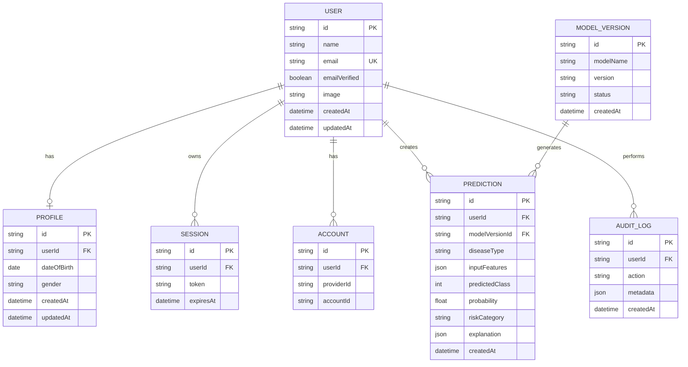

# MediPredict — Database Schema

**Version:** 1.0  
**Status:** Proposed Database Design  
**Database:** PostgreSQL  
**Hosting:** Supabase  
**ORM:** Prisma

---

## 1. Introduction

MediPredict uses PostgreSQL as its primary relational database.

Supabase provides managed PostgreSQL hosting, while Prisma ORM manages database access through the Express application backend.

The database is divided into two logical sections:

1. Authentication and Identity Management.
2. Application Data Management.

Better Auth manages authentication-related tables.

MediPredict manages user profiles, prediction records, model metadata, and administrative data.

## 2. Database Architecture

### 2.1 Database Components

| Component | Responsibility |
|---|---|
| User | Authentication identity |
| Session | User sessions |
| Account | Authentication accounts |
| Verification | Verification records |
| JWKS | JWT signing key records, if generated by the configured plugin |
| Profile | Application user information |
| Prediction | Prediction history |
| ModelVersion | ML model metadata |
| AuditLog | Important administrative events |

## 3. Entity Relationship Diagram



This is the conceptual relationship diagram. The actual Prisma schema is the implementation source of truth.

## 4. Authentication Tables

Better Auth will generate and manage its required database models.

Do not manually recreate or modify generated authentication structures without checking the installed Better Auth version and plugin requirements.

### 4.1 User

Stores authentication identity information.

| Field | Type | Description |
|---|---|---|
| id | String | Primary key |
| name | String | User name |
| email | String | Unique email |
| emailVerified | Boolean | Email verification |
| image | String? | Profile image |
| createdAt | DateTime | Creation time |
| updatedAt | DateTime | Update time |

### 4.2 Session

Stores authenticated user sessions.

| Field | Type | Description |
|---|---|---|
| id | String | Primary key |
| userId | String | User reference |
| token | String | Session token |
| expiresAt | DateTime | Expiration |
| createdAt | DateTime | Creation time |
| updatedAt | DateTime | Update time |

### 4.3 Account

Stores authentication provider account information.

| Field | Type | Description |
|---|---|---|
| id | String | Primary key |
| userId | String | User reference |
| accountId | String | Provider account ID |
| providerId | String | Authentication provider |
| password | String? | Hashed password, when applicable |
| createdAt | DateTime | Creation time |
| updatedAt | DateTime | Update time |

### 4.4 Verification

Stores verification-related information.

Examples:
- Email verification.
- Password reset.
- Other verification tokens.

### 4.5 JWKS

The Better Auth JWT Plugin may require a JWKS model for signing-key management.

The exact fields and table structure must be generated according to the installed plugin version.

## 5. Application Tables

### 5.1 Profile

Stores additional application-specific user information.

| Field | Type | Constraints |
|---|---|---|
| id | String | Primary Key |
| userId | String | Unique, Foreign Key |
| dateOfBirth | DateTime? | Optional |
| gender | Gender? | Optional |
| createdAt | DateTime | Required |
| updatedAt | DateTime | Required |

Relationship:

```text
User (1) -------- (0..1) Profile
```

A profile is optional and belongs to one user.

Do not duplicate authentication email or password information in Profile.

### 5.2 Prediction

Stores user prediction records.

| Field | Type | Constraints |
|---|---|---|
| id | String | Primary Key |
| userId | String | Foreign Key |
| modelVersionId | String | Foreign Key |
| diseaseType | DiseaseType | Required |
| inputFeatures | Json | Required |
| predictedClass | Int | Required |
| probability | Float? | Optional |
| riskCategory | RiskCategory | Required |
| explanation | Json? | Optional |
| createdAt | DateTime | Required |

Relationship:

```text
User (1) -------- (Many) Prediction
```

One user can have multiple predictions.

#### inputFeatures

Stores the validated features used for prediction.

Example:

```json
{
  "glucose": 120,
  "bmi": 28.5,
  "age": 30,
  "bloodPressure": 70
}
```

#### explanation

Stores the SHAP explanation associated with the prediction.

Example:

```json
{
  "method": "SHAP",
  "features": [
    {
      "name": "glucose",
      "value": 120,
      "shapValue": 0.12,
      "direction": "INCREASES_RISK"
    },
    {
      "name": "bmi",
      "value": 28.5,
      "shapValue": 0.05,
      "direction": "INCREASES_RISK"
    }
  ]
}
```

The stored explanation must correspond to the exact model version and prediction.

### 5.3 ModelVersion

Stores ML model metadata.

| Field | Type | Constraints |
|---|---|---|
| id | String | Primary Key |
| modelName | String | Required |
| version | String | Required |
| status | ModelStatus | Required |
| metrics | Json? | Optional |
| artifactReference | String? | Optional |
| createdAt | DateTime | Required |

Example records:

| modelName | version | status |
|---|---|---|
| diabetes-model | 1.0.0 | ACTIVE |
| heart-disease-model | 1.0.0 | ACTIVE |

Model artifacts themselves should be stored in controlled model storage, not directly inside PostgreSQL.

### 5.4 AuditLog

Stores important administrative and security-related events.

| Field | Type | Constraints |
|---|---|---|
| id | String | Primary Key |
| userId | String? | Foreign Key |
| action | String | Required |
| metadata | Json? | Optional |
| createdAt | DateTime | Required |

Examples:
- User account status changed.
- Administrative action performed.
- Account deletion requested.
- Important permission changes.

Never store passwords, authentication tokens, or unnecessary health information in audit logs.

## 6. Enums

### Gender

```prisma
enum Gender {
  MALE
  FEMALE
  OTHER
  PREFER_NOT_TO_SAY
}
```

### DiseaseType

```prisma
enum DiseaseType {
  DIABETES
  HEART_DISEASE
}
```

### RiskCategory

```prisma
enum RiskCategory {
  LOW
  MODERATE
  HIGH
}
```

### ModelStatus

```prisma
enum ModelStatus {
  ACTIVE
  INACTIVE
  TESTING
  DEPRECATED
}
```

Risk categories must be defined using validated model-specific thresholds. They must not be interpreted as medical diagnostic categories.

## 7. Proposed Prisma Application Models

The following is the proposed application-side model design.

Better Auth-generated models must be added using the official schema generation process. The relation names and scalar types must be reconciled with the actual generated schema before applying migrations.

```prisma
enum Gender {
  MALE
  FEMALE
  OTHER
  PREFER_NOT_TO_SAY
}

enum DiseaseType {
  DIABETES
  HEART_DISEASE
}

enum RiskCategory {
  LOW
  MODERATE
  HIGH
}

enum ModelStatus {
  ACTIVE
  INACTIVE
  TESTING
  DEPRECATED
}

model Profile {
  id          String   @id @default(cuid())
  userId      String   @unique
  dateOfBirth DateTime?
  gender      Gender?

  user User @relation(fields: [userId], references: [id], onDelete: Cascade)

  createdAt DateTime @default(now())
  updatedAt DateTime @updatedAt
}

model Prediction {
  id             String       @id @default(cuid())
  userId         String
  modelVersionId String

  diseaseType    DiseaseType
  inputFeatures  Json
  predictedClass Int
  probability    Float?
  riskCategory   RiskCategory
  explanation    Json?

  user User @relation(fields: [userId], references: [id], onDelete: Cascade)

  modelVersion ModelVersion @relation(
    fields: [modelVersionId],
    references: [id]
  )

  createdAt DateTime @default(now())

  @@index([userId, createdAt])
  @@index([diseaseType, createdAt])
  @@index([modelVersionId])
}

model ModelVersion {
  id                String      @id @default(cuid())
  modelName         String
  version           String
  status            ModelStatus @default(TESTING)
  metrics           Json?
  artifactReference String?

  predictions Prediction[]

  createdAt DateTime @default(now())

  @@unique([modelName, version])
}

model AuditLog {
  id        String   @id @default(cuid())
  userId    String?
  action    String
  metadata  Json?

  user User? @relation(fields: [userId], references: [id], onDelete: SetNull)

  createdAt DateTime @default(now())

  @@index([userId, createdAt])
  @@index([action, createdAt])
}
```

The User model above is intentionally not recreated here. It must be the User model generated and maintained by Better Auth, with corresponding Profile, Prediction, and AuditLog relation fields added to it.

## 8. Database Indexing

Recommended indexes:

| Table | Index | Purpose |
|---|---|---|
| User | email UNIQUE | Fast identity lookup |
| Profile | userId UNIQUE | One profile per user |
| Prediction | userId + createdAt | User history |
| Prediction | diseaseType + createdAt | Disease analytics |
| Prediction | modelVersionId | Model analytics |
| ModelVersion | modelName + version UNIQUE | Version identification |
| AuditLog | userId + createdAt | Audit history |

## 9. Data Integrity

- Every prediction must belong to an existing user.
- Every prediction must reference an existing model version.
- Email addresses must be unique.
- Each user can have at most one profile.
- Model versions must be identifiable.
- Prediction history must preserve model version information.
- Invalid foreign-key references must be rejected.
- Database migrations must be version-controlled.

## 10. Data Privacy & Security

Health information is sensitive.

MediPredict must implement:

- Restricted database access.
- Secure connection strings.
- Environment-based credentials.
- User-specific record authorization.
- Minimum necessary data collection.
- Secure deletion procedures.
- Retention policies.
- Encrypted transport.
- Appropriate backups.

Do not expose the Supabase service-role key in frontend code.

The browser must never connect directly to privileged application tables using administrative credentials.

## 11. Database Migration Strategy

Prisma migrations will manage application schema changes.

Suggested commands:

```bash
npx prisma generate
```

```bash
npx prisma migrate dev --name init
```

```bash
npx prisma migrate deploy
```

Use the Better Auth schema generation and migration instructions for the installed version.

Never run destructive migrations against production without reviewing the generated SQL and backing up the database.

## 12. Database Backup & Maintenance

Recommended practices:

- Maintain migration history.
- Use automated database backups.
- Test backup restoration.
- Monitor database connections.
- Review slow queries.
- Keep indexes optimized.
- Avoid unnecessary data duplication.

## 13. Future Database Enhancements

Potential future tables:

- DoctorProfile
- DoctorReview
- HealthReport
- Notification
- UserConsent
- ModelEvaluation
- DatasetVersion

These are outside the initial MVP unless product requirements change.

## 14. Final Database Principles

1. PostgreSQL is the primary database.
2. Supabase provides hosting.
3. Prisma manages application database access.
4. Better Auth manages authentication records.
5. Express manages application persistence.
6. FastAPI does not directly access PostgreSQL in the initial architecture.
7. Every prediction references its model version.
8. Health information must be protected.
9. Database migrations must be version-controlled.
10. Schema changes must be documented.

---

**End of DATABASE_SCHEMA.md**